<div align="center">

<picture>
  <source media="(prefers-color-scheme: dark)" srcset="mobile/assets/logo_on_dark.png">
  
</picture>

# Angkor Stay

**A hotel booking system for a boutique hotel in Siem Reap.**<br>
One Flutter app, one Laravel API, one PostgreSQL database. Three kinds of users: guest, staff and admin.


</div>

---

## Contents

[What it does](#what-it-does) · [Screenshots](#screenshots) · [How it is built](#how-it-is-built) · [Database](#database) · [Run the backend](#run-the-backend) · [Run the mobile app](#run-the-mobile-app) · [Tests](#tests) · [Postman](#postman) · [Security](#security) · [Group](#group)

> **In a hurry?** Start the API with `php artisan serve --host=0.0.0.0 --port=8000` in `backend/`, then run `flutter run` in `mobile/`. Full steps are [below](#run-the-backend).

## What it does

| Role | What they can do |
|---|---|
| **Guest** | Register with a 6-digit email code. Browse room types and photos. See "X rooms left" for the chosen dates. Book a room (held for 5 minutes). Pay online by card or QR code (**15% off**) or pay at the hotel. QR receipt, cancel with refund, edit profile. |
| **Staff** | Find a booking, take payment at the desk (cash, card, KHQR), check in and check out by scanning the guest's QR code. The staff name is saved on every payment. |
| **Admin** | Dashboard (today, rooms, money, last 7 days). Manage room types, prices and rooms. Manage staff accounts. Settings: online discount, check-in and check-out times, allowed network. |

**Main rules**

- The room is checked before any payment. A database row lock makes the first guest win.
- Staff and admin can only use the API from allowed networks (the hotel Wi-Fi).
- A guest who never comes becomes a **no-show** at 12:00 the next day, and online money is refunded.
- Online payment is **simulated** on purpose: no bank is called, no real money moves, no payment keys are needed.

## Screenshots

### Videos

<table>
  <tr>
    <td align="center" valign="top" width="33%">
      <b>Guest</b><br>log in, book, pay<br><br>
      <video src="https://github.com/user-attachments/assets/3e2a8f02-4912-4942-8c9e-968bbf32b3a9" width="240" controls muted playsinline poster="assets/guest-demo.gif"></video><br>
      <sub>Press play (41 s)</sub>
    </td>
    <td align="center" valign="top" width="33%">
      <b>Staff</b><br>pay, check in, check out<br><br>
      <video src="https://github.com/user-attachments/assets/4626a01c-37dc-4a07-8fd8-c01554bbb95e" width="240" controls muted playsinline poster="assets/staff-demo.gif"></video><br>
      <sub>Press play (52 s)</sub>
    </td>
    <td align="center" valign="top" width="33%">
      <b>Admin</b><br>rooms, staff, settings<br><br>
      <video src="https://github.com/user-attachments/assets/1b2e484c-7020-4702-9259-a0bd248850b5" width="240" controls muted playsinline poster="assets/admin-demo.gif"></video><br>
      <sub>Press play (37 s)</sub>
    </td>
  </tr>
</table>

### All roles

<table>
  <tr>
    <td align="center"><a href="https://github.com/HengRatana404/angkor-stay/raw/main/assets/screenshots/guest-home.png">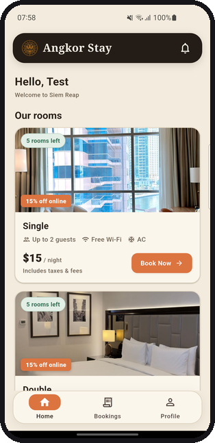</a><br><sub><b>Guest</b><br>Find a room</sub></td>
    <td align="center"><a href="https://github.com/HengRatana404/angkor-stay/raw/main/assets/screenshots/room-detail.png">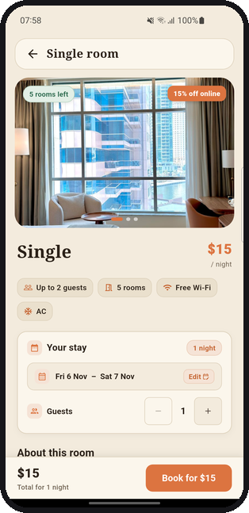</a><br><sub><b>Guest</b><br>Room and price</sub></td>
    <td align="center"><a href="https://github.com/HengRatana404/angkor-stay/raw/main/assets/screenshots/booking-hold.png">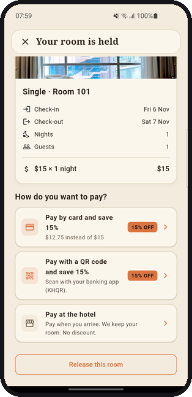</a><br><sub><b>Guest</b><br>5-minute hold</sub></td>
    <td align="center"><a href="https://github.com/HengRatana404/angkor-stay/raw/main/assets/screenshots/pay-khqr.png">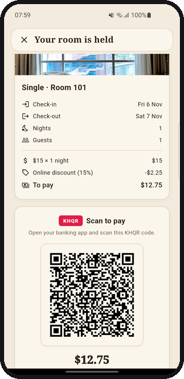</a><br><sub><b>Guest</b><br>Pay with KHQR</sub></td>
  </tr>
  <tr>
    <td align="center"><a href="https://github.com/HengRatana404/angkor-stay/raw/main/assets/screenshots/booking-paid.png">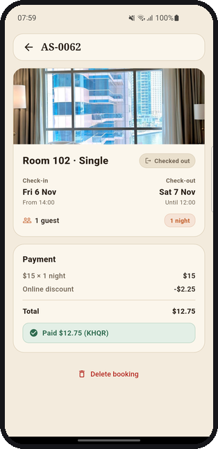</a><br><sub><b>Guest</b><br>Paid booking</sub></td>
    <td align="center"><a href="https://github.com/HengRatana404/angkor-stay/raw/main/assets/screenshots/staff-bookings.png">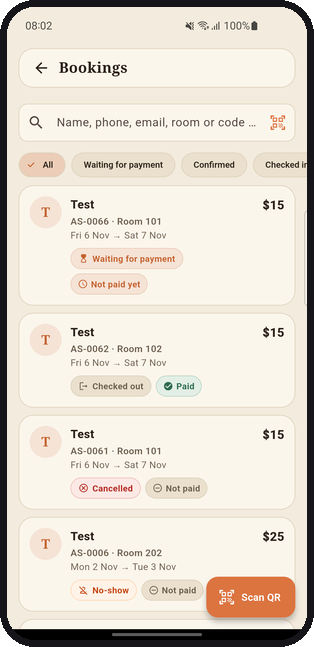</a><br><sub><b>Staff</b><br>Bookings list</sub></td>
    <td align="center"><a href="https://github.com/HengRatana404/angkor-stay/raw/main/assets/screenshots/staff-detail.png">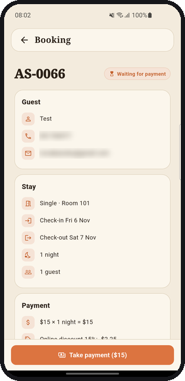</a><br><sub><b>Staff</b><br>Take payment, check in</sub></td>
    <td align="center"><a href="https://github.com/HengRatana404/angkor-stay/raw/main/assets/screenshots/admin-dashboard.png">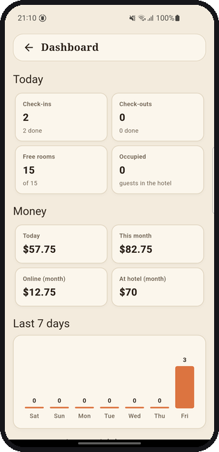</a><br><sub><b>Admin</b><br>Dashboard</sub></td>
  </tr>
  <tr>
    <td align="center"><a href="https://github.com/HengRatana404/angkor-stay/raw/main/assets/screenshots/admin-home.png">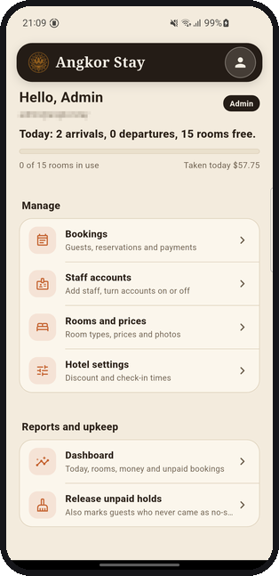</a><br><sub><b>Admin</b><br>Home: manage the hotel</sub></td>
    <td align="center"><a href="https://github.com/HengRatana404/angkor-stay/raw/main/assets/screenshots/admin-rooms.png">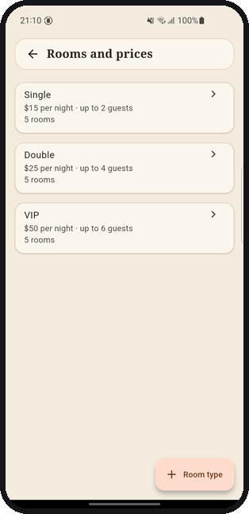</a><br><sub><b>Admin</b><br>Rooms and prices</sub></td>
    <td></td>
    <td></td>
  </tr>
</table>

<details>
<summary>Dark mode</summary>
<br>
<a href="https://github.com/HengRatana404/angkor-stay/raw/main/assets/screenshots/guest-home-dark.png">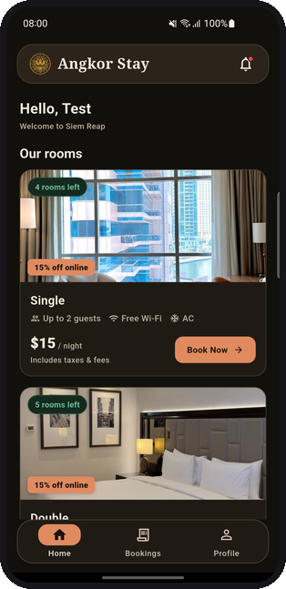</a>
</details>

## How it is built

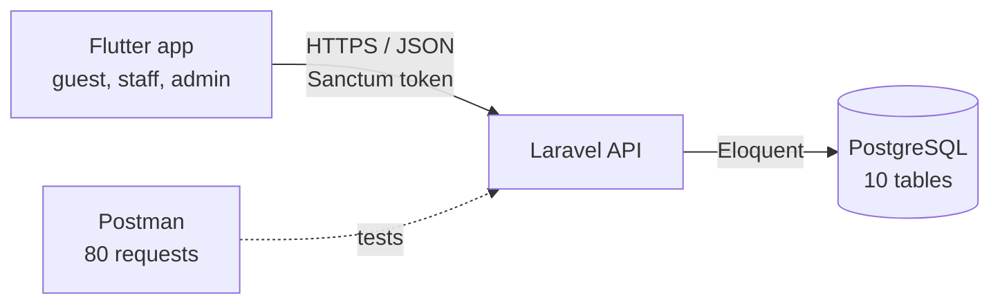

| Part | Folder | Tech |
|---|---|---|
| Mobile app | [`mobile/`](mobile) | Flutter 3, Riverpod, dio, Material 3 (light and dark) |
| API | [`backend/`](backend) | Laravel 13, PHP 8.3+, Sanctum tokens |
| Database | PostgreSQL 18 | 10 tables, made by the migrations in [`backend/database/migrations/`](backend/database/migrations) |
| API tests | [`postman/`](postman) | 80 saved requests with tests |

## Database

10 tables. The three main ones are **rooms**, **bookings** and **payments**. The other seven support them (users, room types and photos, payment tries, settings, email codes, tokens).

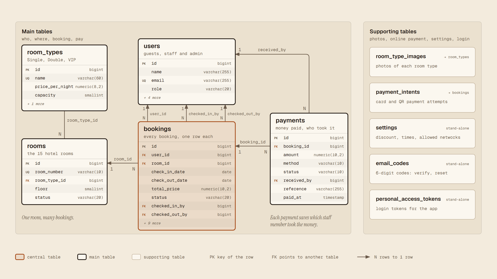

## Run the backend

You need PHP 8.3+, Composer and PostgreSQL.

```bash
cd backend
composer install
cp .env.example .env          # on Windows: copy .env.example .env
php artisan key:generate
```

Create the databases (one for the app, one for the tests):

```bash
createdb angkor_stay
createdb angkor_stay_test
```

Open `backend/.env` and set at least `DB_PASSWORD`, `SEED_ADMIN_PASSWORD` and `SEED_STAFF_PASSWORD` (your own passwords, 8+ characters). Then:

```bash
php artisan migrate --seed    # tables, 3 room types, 15 rooms, 1 admin, 1 staff
php artisan serve --host=0.0.0.0 --port=8000
```

Check it: open http://127.0.0.1:8000/api/health. It should say `"status":"ok"`.

- **Emails (verify and reset codes):** by default `MAIL_MAILER=log`, so the code is written to `backend/storage/logs/laravel.log`. For real emails set the `MAIL_*` values (for example Gmail SMTP with an app password).
- **Accounts:** the seeded admin and staff emails are in `.env` (`SEED_ADMIN_EMAIL`, `SEED_STAFF_EMAIL`). Guests register in the app.
- **Rooms:** 15 rooms. 101-105 Single ($15, up to 2 guests), 201-205 Double ($25, up to 4), 301-305 VIP ($50, up to 6).

<details>
<summary><b>Online payment (simulated)</b></summary>
<br>

Paying online is **simulated**: no bank is called and no real money moves, so there are no payment keys to set up.

- **Card:** any card number of 12 to 19 digits works (no bank check). The date must be written as `MM/YY` and the card must not be expired. A card is good until the end of the month on it, so `11/26` works all through November 2026. Only the brand and the last 4 digits are saved. The full number and the CVV are never saved.
- **QR code:** the app shows a real-format **KHQR** code (the text follows the EMV QR layout that banking apps read, with a demo merchant account, so nobody is ever paid). The guest taps "I have paid".

Both ways are checked **in the database**: every payment is first saved as a row in `payment_intents`. The server re-reads that row and checks it (still open, not expired, right booking, right amount) before it confirms the booking and saves the payment. A refund (cancel, no-show) marks the payment as refunded.

</details>

<details>
<summary><b>Helpful commands</b></summary>
<br>

```bash
php artisan hotel:network show      # who may log in as staff/admin (also: on, off, or a list of networks)
php artisan hotel:clean-up          # free old holds, mark no-shows, refund online payments
php artisan schedule:work           # runs hotel:clean-up every minute
```

If you lock yourself out of the admin account by setting the wrong network, run `php artisan hotel:network off`.

</details>

## Run the mobile app

You need Flutter 3 and an Android phone or emulator.

```bash
cd mobile
flutter pub get
flutter run
```

- **Same Wi-Fi:** start the API with `--host=0.0.0.0` (see above). The app looks for the server on the Wi-Fi it is on and connects by itself.
- **Over the internet (optional):** copy `mobile/dart_defines.example.json` to `mobile/dart_defines.json`, fill in your tunnel address and key, then run `flutter run --dart-define-from-file=dart_defines.json`. This file is git-ignored.
- **Real phone on USB:** run `adb reverse tcp:8000 tcp:8000` first.

Log in as the seeded admin or staff, or register a guest.

## Tests

```bash
cd backend && php artisan test          # 293 tests (needs the angkor_stay_test database)
cd mobile  && flutter test              # 222 tests
cd mobile  && flutter analyze           # no issues
```

## Postman

Import [`postman/angkor-stay.postman_collection.json`](postman/angkor-stay.postman_collection.json). No environment is needed: every request has the full address. Type the account emails and passwords in the collection's **Variables** tab and run folders 0 to 7 in order (70 requests, 113 checks pass). Details: [postman/README.md](postman/README.md).

<table>
  <tr>
    <td align="center">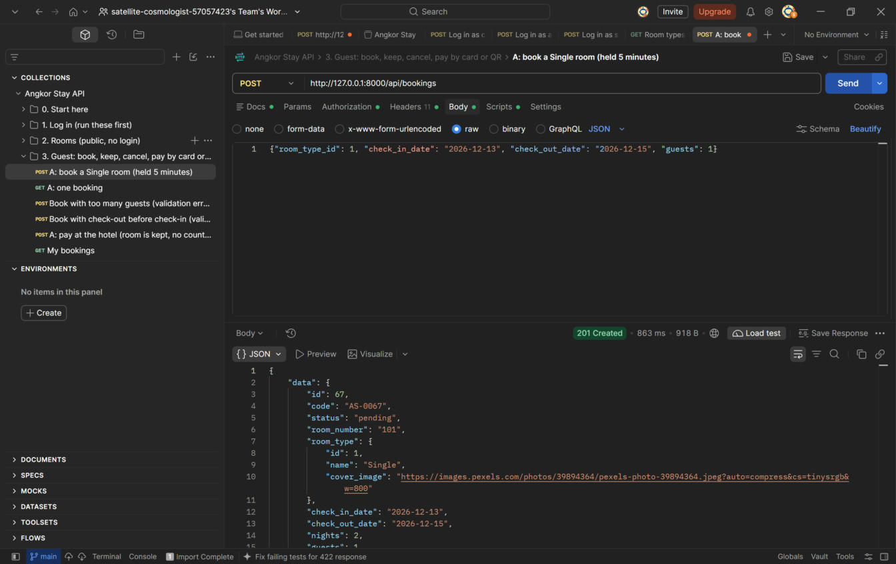<br><sub>201: room booked</sub></td>
    <td align="center">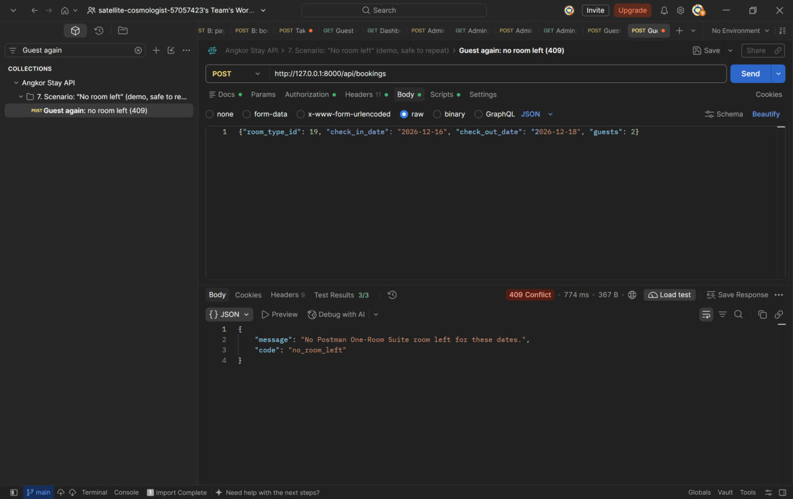<br><sub>409: no room left</sub></td>
    <td align="center">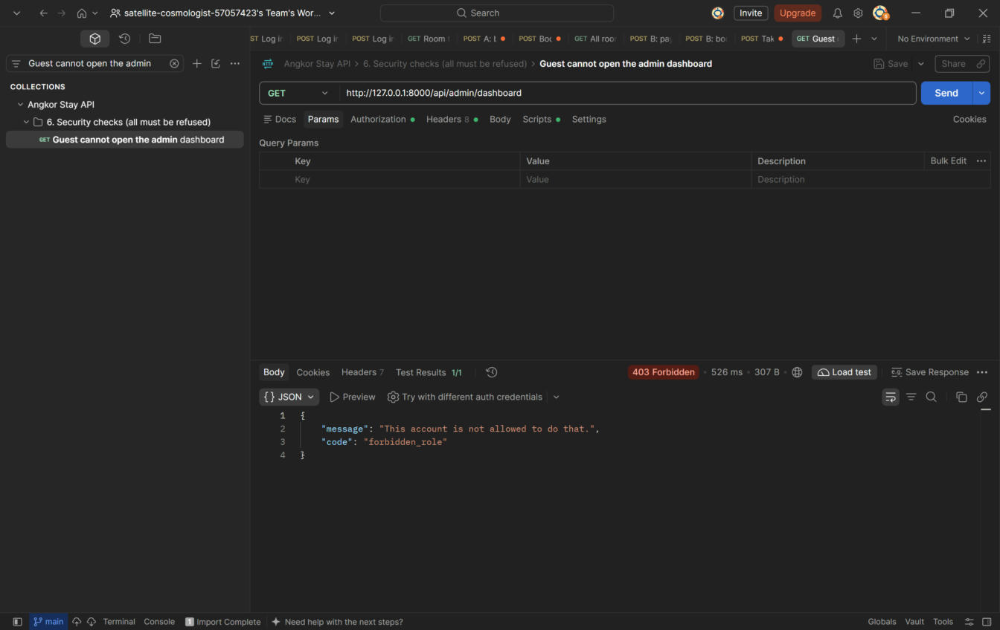<br><sub>403: guest blocked from admin</sub></td>
  </tr>
</table>

## Security

No keys or passwords are in this repository. `backend/.env` is git-ignored; `backend/.env.example` has empty values for every secret.

## Group

- Sa Rosmy
- Meng Theth
- Sokhorn Samnang
- Heng Ratana

**Source code:** https://github.com/HengRatana404/angkor-stay<br>
**Presentation video:** _link coming soon_
